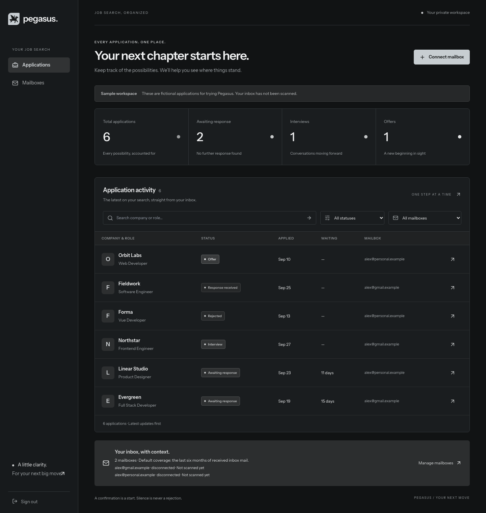
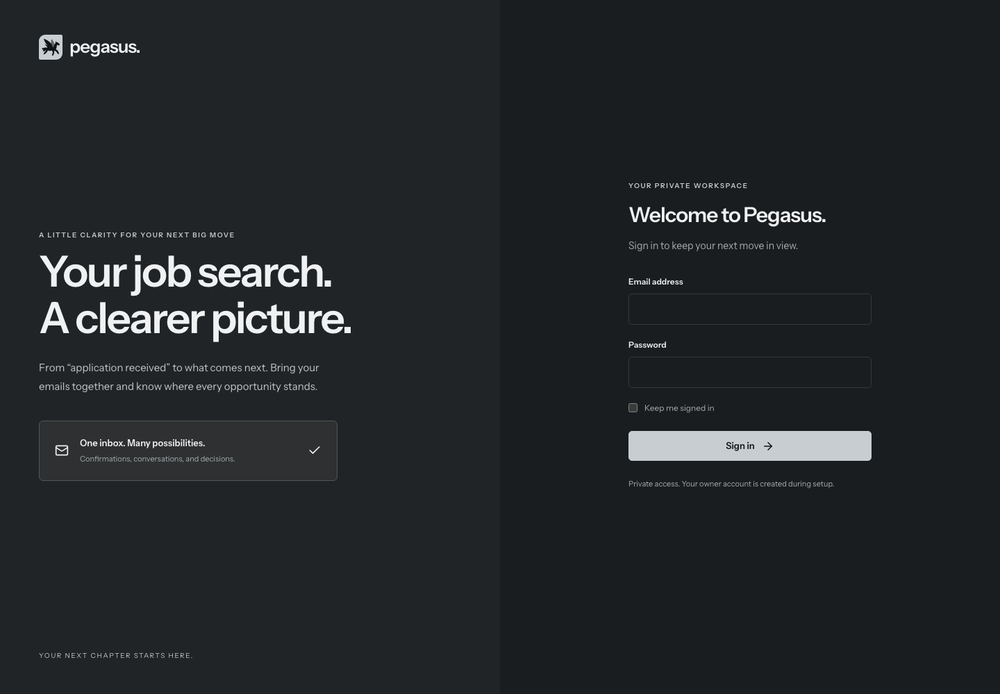
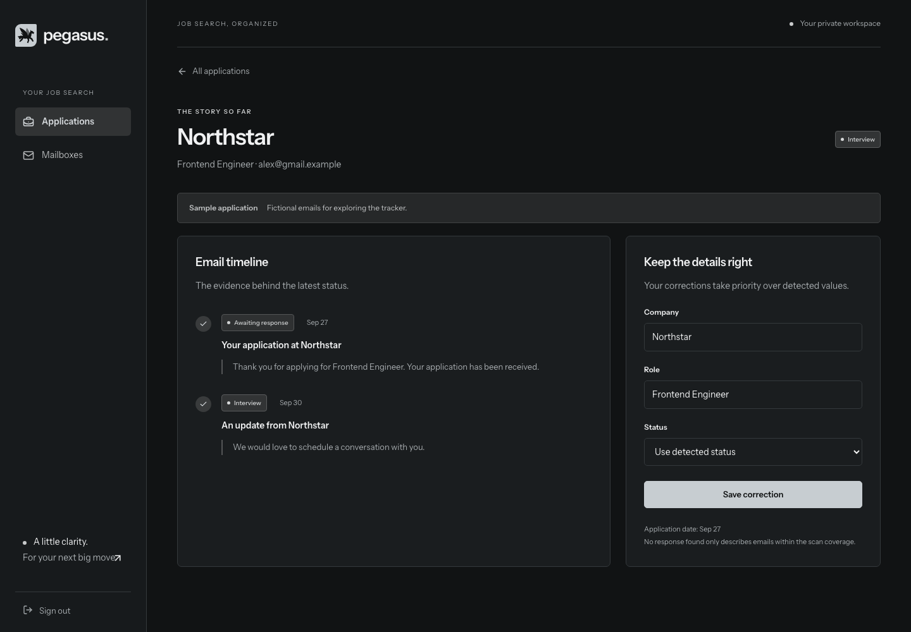
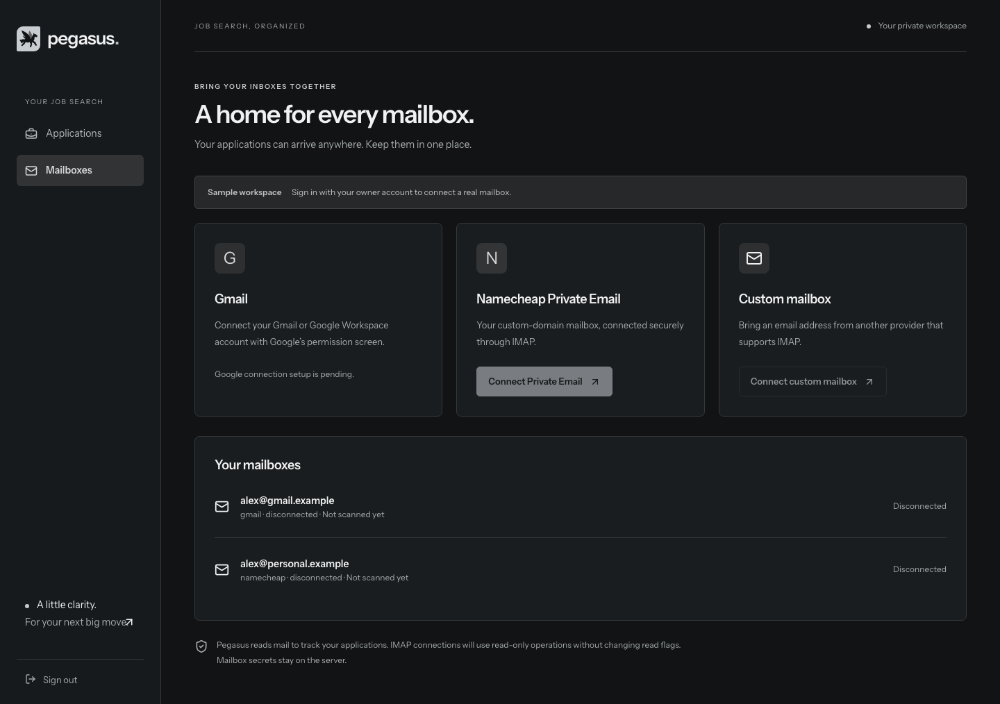
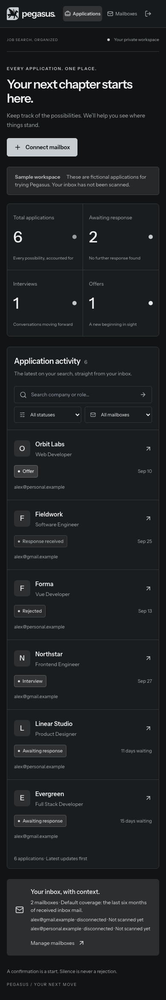
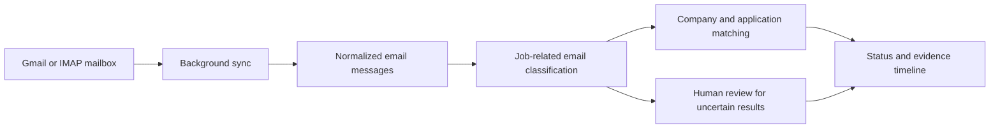

# Pegasus

**A clearer picture of your job search.**

Pegasus is an open-source, self-hosted job application tracker built with **Laravel and Vue**. Its goal is to bring job-related emails from Gmail, Namecheap Private Email, and other IMAP mailboxes into one place, showing which companies have replied and which applications are still waiting.

The current build provides a private workspace, mailbox connection setup, a searchable application dashboard, email evidence timelines, and manual corrections. It uses a charcoal, gunmetal, and silver interface with a full Pegasus logo.

> **Early development:** automatic email importing and classification are not implemented yet. Connecting a mailbox currently verifies or authorizes the connection and stores its credentials; it does not scan your inbox or create applications. The demo contains fictional records. See [current progress](docs/PROGRESS.md) for the implementation status.



## Contents

- [Features and current status](#features-and-current-status)
- [Screenshots](#screenshots)
- [Quick start](#quick-start)
- [Try the demo](#try-the-demo)
- [How it works](#how-it-works)
- [Connect your mailboxes](#connect-your-mailboxes)
- [Configuration](#configuration)
- [Architecture](#architecture)
- [Development and checks](#development-and-checks)
- [Roadmap](#roadmap)
- [Contributing](#contributing)
- [License](#license)

## Features and current status

| Capability | Current build |
| --- | --- |
| Private owner account | Available: password login, logout, login throttling, and command-line password reset |
| Google identity sign-in | Available for initial owner setup; linking to an existing password account is pending |
| Gmail connection | Read-only OAuth consent and encrypted token storage; importing is pending |
| Namecheap Private Email | IMAP connection test and encrypted credential storage |
| Custom-domain mailboxes | Compatible IMAP servers permitted by the server's host allowlist |
| Multiple mailboxes | Separate connection records and independent local disconnect controls |
| Application dashboard | Search, status/mailbox filters, pagination, summary counts, and waiting days |
| Application details | Email event timeline with evidence excerpts |
| Corrections | Edit company, role, and status; restore the detected status |
| Responsive layout | Desktop table and mobile application cards |
| Sample workspace | Local-only demo with six fictional applications and sample mailbox records |
| Automatic inbox scans | Planned |
| Email classification and matching | Planned |
| Review queue and scan progress | Planned |

Real Gmail and IMAP connections have not yet been verified with live owner credentials. This is a development preview, with a working interface and connection foundation.

## Screenshots

All screenshots use fictional demo data and the current charcoal/silver theme. No real mailbox contents or credentials are shown.

### Private login



### Application timeline and corrections



### Mailbox connections

The sample mailbox records are disconnected. Gmail authorization and live IMAP connections require a separate owner account.



### Mobile workspace



## Quick start

### Requirements

- PHP **8.3 or later**, with the extensions required by the locked Composer dependencies and PDO SQLite for the default database.
- Composer **2**.
- Node.js **22** and npm, matching the development environment used for this build.
- A local checkout of this repository.

Gmail credentials and an IMAP mailbox are optional for trying the demo.

### Install and run

From the repository root:

```sh
# Preserve an existing local configuration.
[ -f .env ] || cp .env.example .env

composer install
composer check-platform-reqs
npm ci --ignore-scripts

# Run this once on a fresh installation.
php artisan key:generate

# Create the SQLite database if it does not exist.
[ -f database/database.sqlite ] || touch database/database.sqlite
php artisan migrate

npm run build
php artisan pegasus:owner you@example.com
php artisan serve --host=127.0.0.1 --port=8000
```

Open [http://localhost:8000](http://localhost:8000) and sign in with the email and password you chose. The owner command privately prompts for a password of at least 12 characters and confirmation. There is no default owner password or public sign-up page.

Do not regenerate `APP_KEY` on an existing installation: stored mailbox credentials and evidence are encrypted with that key.

To reset the owner's password:

```sh
php artisan pegasus:owner you@example.com --reset
```

Use the existing owner's email. The current application supports one real owner per installation, plus the separate local demo account.

## Try the demo

Set this value in your local `.env`:

```dotenv
PEGASUS_DEMO_ENABLED=true
```

If configuration was cached, run `php artisan config:clear`. Then open [http://localhost:8000/demo](http://localhost:8000/demo).

The demo signs you in automatically. You can search applications, view the evidence timeline, change a status, and restore its detected value without connecting any email accounts.

- Demo data is fictional; it is not generated by an email classifier.
- The demo account cannot connect real mailboxes.
- `/demo` is disabled unless both `APP_ENV=local` and the demo setting are enabled.
- Set `PEGASUS_DEMO_ENABLED=false` when using your real owner workspace.

A new real owner workspace starts empty. Connecting a mailbox will not populate it until the import and classification pipeline is implemented.

## How it works

### The current workflow

1. **Create an owner account.** Provision it privately from the command line, then log in through the browser.
2. **Connect a mailbox.** Authorize Gmail read-only access or enter a permitted IMAP server's connection details. Each mailbox has its own connection record.
3. **Browse application records.** The dashboard groups existing records by their effective status and lets you search by company or role, or filter by mailbox and status. At present, the local demo is the supplied way to explore populated records.
4. **Inspect the evidence.** Open an application to see its dated email events and evidence excerpts.
5. **Correct a record.** Update the company or role, or choose a manual status. The manual status takes precedence over the detected status; clearing it restores the detected value.
6. **Disconnect independently.** Local credentials are removed while application history is retained. Remote Google token revocation is still pending; revoke Pegasus in your Google account if you also want to remove provider-side authorization.

### Application statuses

| Status | Meaning in the tracker |
| --- | --- |
| Awaiting response | The record is waiting for a further company response |
| Response received | A response is recorded without a more specific outcome |
| Interview | An interview stage is recorded |
| Offer | An offer is recorded |
| Rejected | A rejection is recorded |
| Needs review | The record needs a human decision |

Waiting days are calculated from the application date only for records whose effective status is **Awaiting response**. Missing dates are shown as unknown. Counts summarize all of the owner's application records, while filters narrow the list.

A recorded status is not proof that every email has been checked. Automatic scanning and full review processing are still on the roadmap.

### The planned email pipeline

The intended next stage is:



This pipeline is a design target, not a running feature. It will distinguish application confirmations, ordinary replies, interviews, offers, and rejections, and attach supporting email evidence to each result. The classification provider has not been selected or integrated.

## Connect your mailboxes

### Gmail

Gmail uses Google OAuth instead of asking for your Gmail password. Signing into Pegasus with Google and authorizing a mailbox are separate flows.

1. Create a Google Cloud project, enable the Gmail API, and configure the OAuth consent screen. Add the intended account as a test user if your project is in testing mode.
2. Create a Web application OAuth client.
3. Register these exact callback URLs for the default local setup:

   ```text
   http://localhost:8000/auth/google/callback
   http://localhost:8000/settings/gmail/callback
   ```

4. Add the client ID and secret to `.env`:

   ```dotenv
   PEGASUS_OWNER_EMAIL=you@example.com
   GOOGLE_CLIENT_ID=your-client-id
   GOOGLE_CLIENT_SECRET=your-client-secret
   GOOGLE_REDIRECT_URI=http://localhost:8000/auth/google/callback
   GOOGLE_GMAIL_REDIRECT_URI=http://localhost:8000/settings/gmail/callback
   ```

5. Sign in with your provisioned owner password, open **Mailboxes**, and connect Gmail.

Keep the browser origin, `APP_URL`, and callback URLs consistent. If you use `127.0.0.1` instead of `localhost`, update and register the callback URLs accordingly.

For Google identity sign-in to create the first owner, no real owner may already exist and the verified Google email must match `PEGASUS_OWNER_EMAIL`. Linking Google identity to an existing password account is not implemented; that owner can still authorize Gmail after password login.

Pegasus requests `gmail.readonly`, not permission to send or delete mail. Google classifies this as a restricted scope, so public use can require additional verification. Consult [Google's Gmail scope documentation](https://developers.google.com/workspace/gmail/api/auth/scopes) and [server-side authorization guide](https://developers.google.com/workspace/gmail/api/auth/web-server) for provider requirements.

### Namecheap Private Email

Open **Mailboxes**, choose the Namecheap option, and enter the mailbox's address, username, and password in the protected form.

| Setting | Value |
| --- | --- |
| IMAP hostname | `mail.privateemail.com` |
| Port | `993` |
| Encryption | TLS/SSL |
| Username | Full mailbox email address |
| Credential | Mailbox password, rather than your Namecheap account password |

These connection settings follow [Namecheap's official Private Email configuration guide](https://www.namecheap.com/support/knowledgebase/article.aspx/1179/2175/general-private-email-configuration-for-mail-clients-and-mobile-devices/). Follow your provider's current credential instructions for your account. No SMTP configuration is needed.

A domain registered at Namecheap is not automatically a Namecheap Private Email mailbox; the actual email hosting provider determines the connection settings.

### Custom domains and other IMAP providers

Add the provider's IMAP hostname to the server-side allowlist:

```dotenv
IMAP_ALLOWED_HOSTS=mail.privateemail.com,imap.example.com
```

Then use the custom IMAP option and the provider's supported username, password, and encryption settings. The current form supports port `993` with SSL or port `143` with STARTTLS. It verifies TLS and tests a read-only INBOX open before saving the connection.

Connections to private/reserved network addresses are blocked. This first adapter requires a public IPv4 address; IPv6-only servers are not supported. Compatible IMAP support does not imply every provider has been live-tested.

## Configuration

| Variable | Purpose |
| --- | --- |
| `APP_URL` | Application origin; keep it consistent with OAuth callbacks |
| `APP_KEY` | Laravel encryption key; preserve it alongside protected backups |
| `DB_CONNECTION` | Defaults to `sqlite` |
| `QUEUE_CONNECTION` | Defaults to `database`; future sync jobs will use background processing |
| `PEGASUS_OWNER_EMAIL` | Allowed verified email for initial Google identity owner creation |
| `GOOGLE_CLIENT_ID`, `GOOGLE_CLIENT_SECRET` | Google OAuth client credentials |
| `GOOGLE_REDIRECT_URI` | Google identity callback |
| `GOOGLE_GMAIL_REDIRECT_URI` | Gmail mailbox-consent callback |
| `IMAP_ALLOWED_HOSTS` | Comma-separated permitted IMAP hostnames |
| `PEGASUS_DEMO_ENABLED` | Enables the fictional workspace only in the local environment |

Keep `.env`, database files, access tokens, mailbox passwords, and real email evidence out of Git. Credentials and evidence excerpts are encrypted database fields; the entire database is not encrypted, and metadata such as subjects and company names is not covered by those field-level encryption casts.

## Architecture

Pegasus uses **Laravel 13**, **Vue 3**, **TypeScript**, **Inertia 2**, **Tailwind CSS**, and **Vite**. Laravel handles sessions, validation, ownership checks, and persistence. Inertia delivers server-provided data to Vue pages without a separate public API service.

- **SQLite** is the default local database.
- **Laravel Socialite** handles Google OAuth.
- **Webklex PHP-IMAP** handles IMAP connection testing.
- **Pest/PHPUnit** cover backend behavior; **Playwright** covers browser journeys.

| Location | Responsibility |
| --- | --- |
| `app/Actions/` | Local demo workspace creation |
| `app/Console/Commands/` | Private owner provisioning and password reset |
| `app/Http/Controllers/` | Authentication, application records, and mailbox connections |
| `app/Http/Requests/` | Form validation and IMAP connection rules |
| `app/Models/` | Owners, mailbox records, messages, applications, and evidence events |
| `app/Services/Mail/` | IMAP connection testing |
| `resources/js/` | Vue pages, shared components, layouts, and TypeScript contracts |
| `resources/css/app.css` | Pegasus theme and responsive layout |
| `database/migrations/` | Database schema |
| `tests/` | Backend and browser tests |
| `docs/`, `SPEC*.md`, `tasks/` | Scope, implementation status, specifications, and work plan |

Applications belong to an owner and can reference a mailbox. Email events belong to applications, with evidence encrypted at rest. Queries scope records to the signed-in owner. Mailbox credentials are encrypted and hidden from serialized responses.

## Development and checks

For the Laravel server, frontend hot reload, queue listener, and logs together:

```sh
composer run dev
```

Stop a separately running server first if it already occupies port 8000. Running the queue listener does not enable email syncing in this build.

| Command | Purpose |
| --- | --- |
| `npm run dev` | Vite frontend development server |
| `npm run build` | Compile frontend assets |
| `npm run typecheck` | Check Vue and TypeScript types |
| `php artisan test` | Run backend tests |
| `./vendor/bin/pint --test` | Check PHP formatting |
| `npm audit` | Check npm dependency advisories |
| `composer audit` | Check Composer dependency advisories |

For browser tests, enable the local demo and run the application on `127.0.0.1:8000`, then:

```sh
npx playwright install chromium
npx playwright test
```

The browser suite checks the fictional workspace at desktop, phone, and small-phone sizes. It exercises filtering, timeline details, saved corrections, and mailbox navigation. It changes sample records and restores the detected status afterward.

For the exact verified build and remaining gaps, read [PROGRESS.md](docs/PROGRESS.md). Do not treat historical test or audit results as a guarantee for a different checkout or later dependency state.

## Roadmap

- [ ] Gmail token refresh and remote token revocation.
- [ ] Reliable initial and incremental Gmail/IMAP syncing.
- [ ] Email normalization and deduplication.
- [ ] Evidence-backed email classification and application matching.
- [ ] Human review for uncertain results.
- [ ] Scan progress, coverage, and update indicators.
- [ ] Google identity linking for existing password accounts.
- [ ] Data deletion controls and background-job race handling.
- [ ] Live mailbox verification and production deployment hardening.

The detailed design is in the [product scope](docs/SCOPE.md), [capability map](CAPABILITY-MAP.md), [shared specification](SPEC.md), and [implementation plan](tasks/plan.md). These documents describe both implemented and planned behavior; [current progress](docs/PROGRESS.md) is the reference for what is available today.

## Contributing

Contributions are welcome. Open an issue describing the problem or proposed feature before a substantial change, then submit a focused pull request with the behavior change and relevant verification results.

Use the existing Laravel/Vue structure, keep ownership checks and credential handling intact, and add tests for changes to behavior. Use fictional fixtures rather than real email contents. Update the documentation when implementation status changes, and include screenshots for interface changes.

Do not post mailbox credentials, OAuth tokens, or private email contents in issues or pull requests. Report security-sensitive findings privately to the repository maintainer.

## License

Pegasus is available under the [MIT License](LICENSE).
